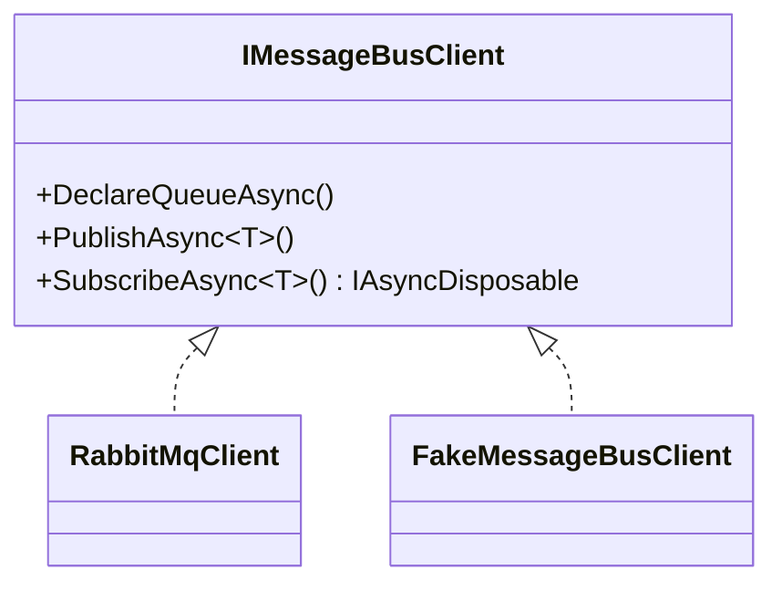

# Auxilia.Messaging

Thin transport abstraction over RabbitMQ. All other projects depend on `IMessageBusClient`, never on RabbitMQ types directly, so tests can inject `FakeMessageBusClient`.

## Architecture

`RabbitMqClient` uses one shared channel for publishing and creates a dedicated channel per `SubscribeAsync` call. W3C trace context is injected into message headers on publish and extracted on receive, keeping distributed traces connected across process boundaries. The `IAsyncDisposable` returned by `SubscribeAsync` tears down that channel.

Publish semantics: the publish channel runs with **publisher confirmations tracked by the library** (`CreateChannelOptions(publisherConfirmationsEnabled, publisherConfirmationTrackingEnabled)`), so every `Publish*Async` completes only once the broker confirmed the message and throws `PublishException` on a nack/return — a message the broker never took is never reported as sent. Subscription dispose is leak-proof: the courtesy `BasicCancelAsync` is guarded (a channel closed by recovery makes it throw), and the consumer channel, the topic handle's bind channel, and its gate are released in nested `finally` blocks.

Testing: the subscription handles are `internal` and unit-tested against Moq'd channels in `Tests/Libraries/Auxilia.Messaging.Tests`; everything with broker semantics (confirmations, ack/nack, routing, recovery) is covered only by the Docker system suite under `Tests/System/Auxilia.SystemTestSuite/Messaging/`.

Workload attribution (2026-10-15): every publish sets `BasicProperties.UserId` to the connection's user — RabbitMQ validates it, so it is an authenticated publisher identity. The consumer pipeline drops (nack, no requeue; `messaging.attribution.rejected.count`) an `IWorkloadScopedMessage` whose publisher is a workload identity (`WorkloadBusIdentity.UserNamePrefix`) other than the instance it names, or is unattributed, and any `IPlatformOnlyMessage` from a workload or unattributed publisher. Platform service accounts must never use the workload prefix. A client created with `queuePublishExchange` (a workload's ingress) routes `PublishAsync(queue)` through that exchange under the queue name, `mandatory` (an unbound queue fails loudly). `BindQueueAsync` (default no-op for fakes) binds a platform queue to an exchange. `IBrokerIdentityIssuer` / `RabbitMqManagementIdentityIssuer` mint (fresh random password, no tags, vhost + topic permissions, rollback on partial failure, retried transient errors) and revoke workload users over the management HTTP API.

Consumer semantics (all subscription variants share one pipeline):
- Every delivery is explicitly acked or nacked. A throwing handler nacks the delivery: a first delivery is requeued for one retry, an already-redelivered message is dropped as poison — resilience lives inside the client (repo rule), never in callers or decorators. A body that deserializes to `null` is nacked without requeue instead of being acked as handled. Failures are logged via the optional `ILogger` passed to `CreateAsync`.
- Every consumer channel sets a per-consumer prefetch bound (`BasicQosAsync`, 32, non-global) so one node cannot pull an entire backlog into memory and defeat the competing-consumer shared-queue pattern.
- Topic subscriptions (`SubscribeToTopicExchangeAsync`) use CLIENT-generated queue names (durable, non-exclusive, auto-delete — RabbitMQ 4 refuses transient non-exclusive queues): automatic topology recovery re-declares a client-named queue under the same name after a connection blip, so late `Add`/`RemoveBindingAsync` calls keep working — a server-named queue would come back renamed and every later bind would 404. The handle's dedicated bind channel is created lazily and replaced if recovery closed it.



## File / Folder Map
```
Source/Libraries/Auxilia.Messaging/
├── IMessageBusClient.cs    # The only type consumers should depend on
├── RabbitMqClient.cs       # Production impl; created via CreateAsync() factory, never new
├── IWorkloadScopedMessage.cs / IPlatformOnlyMessage.cs / WorkloadBusIdentity.cs  # Publisher attribution rules
├── IBrokerIdentityIssuer.cs / RabbitMqManagementIdentityIssuer.cs  # Per-workload broker identities
├── MessagingTelemetry.cs   # Shared ActivitySource + metrics instruments
└── Messages/               # IdentificationRequestMessage / IdentificationResponseMessage
```
- `CreateAsync` retries the first connection briefly (`BrokerUnreachableException`, up to 10 attempts) — a broker container that is still starting must not fail the host.
