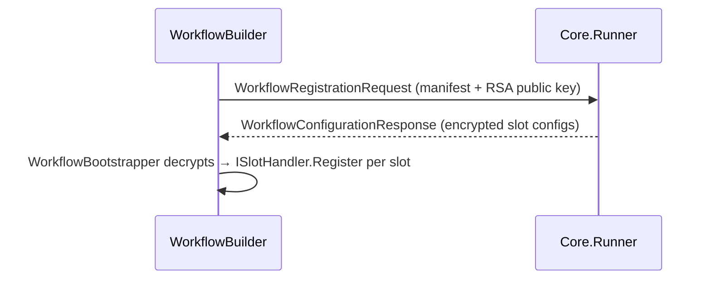

# Auxilia.Workflows

Workflow SDK consumed by every workflow binary. Declares slots and environment requirements, negotiates configuration with the Core.Runner over the message bus, and bootstraps the resolved slot providers into the DI container.

## Architecture

A workflow binary calls `WorkflowBuilder` at startup. When run normally it sends a `WorkflowRegistrationRequest` to the Core.Runner and waits for a `WorkflowConfigurationResponse` containing RSA-encrypted slot configs. `WorkflowBootstrapper` decrypts each config and calls the matching `ISlotHandler` to register the provider into `IServiceCollection`. When run with no args (schema-export mode) it serialises the `WorkflowSchema` to stdout and exits — used by tooling only.

Platform-launched instances read their identity from env vars (`WorkflowEnvironmentVariables`): `Workflow__InstanceId` + one-time `Workflow__InstanceToken` (carried in announcement, registration, slot-activation, and terminal `WorkflowStateMessage` messages for authentication — the runner ignores unauthenticated state reports, and every message that names the workflow must name the type the token was issued for) and `Workflow__AnnouncementQueue`/`Workflow__RegistrationQueue` (the launching Core.Runner's queues). Without them the SDK self-generates an identity — accepted only by a runner running with `RequireInstanceToken=false` (dev mode). The response queue name is always `WorkflowQueues.ResponseQueueFor(instanceId)` — pre-created by the platform in authenticated mode.

Containment (2026-10-15, ARCHITECTURE §7): the instance connects with its OWN broker identity (`RabbitMq__UserName/Password`) and publishes queue messages through `RabbitMq__IngressExchange` — it never declares platform topology (the runner declares the state/views/events exchanges and the signals queue), only its own per-instance queues. Before any workload code runs, `WorkflowBuilder.Run` calls `Sandbox.AgentSandbox.Initialize` (establishes the unprivileged `auxilia-agent` user — uid/gid 10001, provisioned by the IMAGE at build time because workflow containers run on a read-only root filesystem, created on demand only where `/etc` is writable; a root SDK on Linux without `setpriv` or the user REFUSES TO START rather than run agent code as root — then hands it the workspace/output/pod volumes — shared with the SDK via the agent group: the SDK process takes it as its effective group (`setegid`) with umask 002, so files a workflow prepares there stay agent-writable on any filesystem — setgid inheritance is not honored by host shares; never create a root-trusted runtime file without an explicit root-only-writable mode, as `WrapperFor` does), starts `Workspace.GitPushGateway` for every announced `Workflow__PushRemote__<ID>` (repoints the mount's `origin` at the loopback gateway; the credential stays in this process) and — on a platform launch — `AgentSandbox.ScrubPlatformSecrets()` removes bus credentials, the instance token and push remotes from the process environment. Every process running workload-controlled code (agent CLIs via their process factories, `TmuxSessionHost`, `WorkspaceSetup`, `ProcessGitRunner`) goes through `AgentSandbox.Confine` (setpriv to the agent user, platform secrets removed); third-party launchers use `AgentSandbox.WrapperFor`. A provider preparing an agent CLI's state (credentials, hook settings, MCP config) writes it under `AgentSandbox.AgentHome` (the agent user's home while sandboxed) and hands it over with `AgentSandbox.GrantToAgent` — the confined CLI never sees the SDK's own HOME. Agent sessions hold an `AgentSandbox.EnterAgentSession()` lease — when the last ends, every agent-user process is killed. `Actions.ActionGate` is the per-action policy point every enforcement point consults (`GatedAction` with an open-vocabulary kind; the push gateway raises `git.push`): an agent session registers its approver for its lifetime; with none registered the action is the workflow's own and allowed. `WorkflowQueues` + `Messaging.WorkloadBusAccess` are the bus contract a workload identity is minted from.

`SlotHandlerRegistry` is a static map from provider-type string → `ISlotHandler`. Slot-package libraries register their handler into it; the core SDK does not know about any concrete provider.



## Special Rules
- `WorkflowManifest` (sent on the wire) and `WorkflowSchema` (stdout export) are distinct types — never conflate them.
- `EphemeralKeyPair` is `IDisposable`; always `using`.
- `WorkflowBuilder` is `sealed` — new capabilities go into `IWorkflowBuilder` extension methods.
- `SlotHandlerRegistry` is static; no instance state.
- Terminal-state semantics: only the operator's cancel command (the builder's own token) ends a run as
  `Cancelled`/exit 0; any other `OperationCanceledException` (a provider HttpClient timeout, a child's
  own token) is `Failed`/exit 1. Inversely `SlotActivator`/`ResourceProxyClient`/`PodControlClient`
  rethrow the caller's cancellation as `OperationCanceledException`, never as their `TimeoutException`.
- Input files: `RequiresInputFile` names are `WorkflowInputFileDescriptor.IsValidName` (lowercase
  letters, digits, dashes — they become a file name and a variable suffix); `IRunInputFiles` reads
  `WorkflowEnvironmentVariables.InputFileVariable(name)` and throws for an undeclared name. The
  runner owns the delivery path (`InputFileDirectory`) — never let a launch extra set the variable.
- Checkpoints: `DeclaresCheckpoint` names follow the input-file rule, paths
  `WorkflowCheckpointDescriptor.IsValidRelativePath` (relative, no `..`, stored with `/`), the lifetime
  is carried as `LifetimeHours`. `IRunCheckpoints` (`ResourceProxyRunCheckpoints`) sends ONLY the name
  through the resource proxy (resource `run-checkpoints`, op `save`) — the runner takes the path from
  the declaration it registered, so a workflow can never point a save elsewhere — one save at a time,
  and a refused save throws.
- `ProvidesTools` entries are `name` or `name@version` (validated in the builder; matching lives in
  `Auxilia.Core.Contracts.ToolProvisions` — the SDK cannot reference the contracts, so keep the
  builder's format check in step with `ToolProvisions.TryParse`).
- `DefaultViewPublisher` numbers the run's view items with ONE counter across all views, assigned
  and published under one gate (the bus order IS the sequence order; the Core's resumable stream
  depends on it) — never per view, never reuse a number after a failed publish. The builder reports
  its `LastSequence` and the `IRunOutcome` reason with the final state (`WorkflowStateMessage`).
- `OperatorChannel`'s idle state machine (`SessionIdlePolicy`): Busy (a turn runs — no clock),
  Waiting (after `PublishTurnEndedAsync` / a start without an instruction — late agent activity only
  restarts the clock), Expecting (a turn ended after guidance was consumed mid-turn — the agent's
  first activity makes it Busy); an open question always runs the clock; every operator input
  restarts it. `RequestEnd` is the ONE end path (the operator's `end` included): first reason wins,
  open questions are declined, between turns `EndToken` fires at once, otherwise at the turn's end.
- `SlotActivator` stays alive for the whole run and is registered as the run's
  `ISlotConfigurationSource`: a handler fetches its slot again mid-run (a credential that expires or
  is replaced) and gets the connector's current settings. Activation responses are matched by slot
  NAME, so the activator holds one activation per slot in flight (a per-slot gate) — never drop it.
  Absent in bundled-configuration runs (dev hosts, tests): handlers resolve it optionally.

## File / Folder Map
```
Source/Libraries/Auxilia.Workflows/
├── IWorkflowBuilder.cs / WorkflowBuilder.cs   # Fluent builder + schema-export mode (RunAsync)
├── WorkflowBootstrapper.cs                    # Applies decrypted slot configs to IServiceCollection
├── WorkflowSchema.cs / WorkflowManifest.cs    # Schema = stdout export; Manifest = wire format
├── SlotHandlerRegistry.cs / ISlotHandler.cs   # Static registry: providerType string → ISlotHandler
├── Capabilities/                              # ICapability marker + NoCapabilities sentinel
├── Companions/                                # Run pods (test-fabric design §A): RequiresCompanion declarations + builder + CompanionTopologyValidator (digest pinning, bounds, cycles — shared with the Core's registry gate) + RequiresPodControl envelope with IPodController/PodControlClient (runtime spawn over the authenticated pod-control queue)
├── Crypto/                                    # EphemeralKeyPair (RSA-4096) + SlotConfigurationCrypto (decrypt helper)
├── Environment/                               # IEnvironmentRequirement + Tool / Os / Port requirement records
├── Events/                                    # DeclaresEvent descriptors + IEventPublisher/DefaultEventPublisher (workflow.events topic exchange; run.* prefix reserved for the platform; payload cap — big data goes to the artifact store)
├── Internal/EnvironmentBuilder.cs             # internal impl of IEnvironmentBuilder
├── Sandbox/AgentSandbox.cs                    # Unprivileged agent user, secret scrub, Confine/WrapperFor, session leases
├── Actions/ActionGate.cs                      # Per-action policy point (GatedAction, IActionApprover, ActionKinds)
├── Workspace/GitPushGateway.cs                # Loopback git smart-HTTP gateway: holds the push credential, gates every push
├── Messaging/WorkloadBusAccess.cs             # The broker permissions a workload identity is minted with
└── Messaging/Messages/                        # Registration request, config response, encrypted slot config records (workload-scoped / platform-only markers)
```